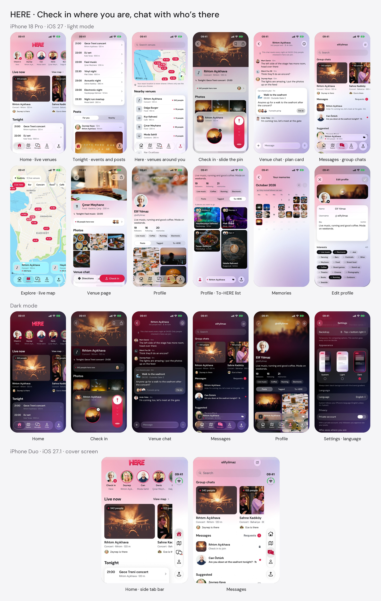

# HERE

A passion project: a social app for nights out, built around places instead of people.

See which venues are live around you, check in when you arrive, and chat with everyone who's there. Chats disappear every night at 4 AM; your photos and memories stay.



## What's inside

- `apps/mobile` – the iOS app (Expo + React Native), running on mock data
- `db` – a PostgreSQL schema that deletes chats every night
- `docs` – notes, design decisions and screenshots

## Try it

```bash
cd apps/mobile
npm install
npx expo run:ios
```

Needs Xcode and an iOS simulator. The app speaks English and Turkish (Settings › Language).
