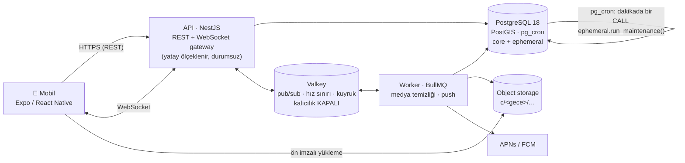
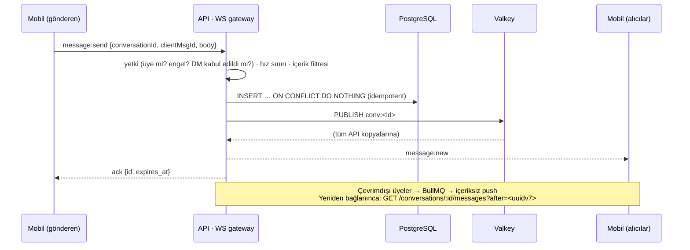

# HERE — Mimari ve Teknoloji Yığını

> Ürün adı **HERE** (K-13). Veritabanı, rol ve servis adlarında hâlâ eski çalışma adı (`anlik_*`) geçiyor; Faz 2'deki şema güncellemesinde `here_*` olarak değiştirilecek.

Konum bazlı, grup aktivitelerine odaklı bir sosyal medya uygulaması. Kullanıcı bulunduğu mekânda (konser alanı, restoran, park…) **yer bildirir** ve isterse fotoğraf ya da yorum paylaşır. Paylaşım ana sayfada görünür, kullanıcı da o mekânda yer bildirmiş kişilerle **mekânın grup sohbetine** katılır. **Her şey gece 04:00'te sıfırlanır.** Paylaşımlar, sohbetler, mesajlar, konum pinleri ve anonim kimlikler kalıcı olarak silinir. (Ürün modelindeki bu değişikliğin şemaya etkisi: §14.)

---

## 1. Ürün ilkelerinden teknik kararlara

| İlke | Teknik karşılığı |
|---|---|
| **Gece biter, her şey biter** (04:00 → 04:00) | Geçici veri "gece" (cycle) başına bölümlenir; 04:00'te RLS ile anında görünmez olur, ≤1 dk içinde `DROP` ile diskten silinir |
| **Dijital ayak izi yok** | Ham GPS asla saklanmaz · Valkey kalıcılığı kapalı · log ve push'ta içerik yok · cihazdaki önbellek de 04:00'te silinir |
| **Yakındakini keşfet ama yerini ele verme** | Izgara maskeleme (~250 m / ~1 km) · mesafe yalnızca kova ("< 500 m") · "görmek için görünür ol" |
| **Gerçekten orada olanlar konuşur** | Mekân sohbeti yalnızca o mekânda yer bildirenlere açık; yer bildirimi için mekâna ~300 m yakınlık sunucuda doğrulanır |
| **Anlık ve anonim kalabilme** | Kalıcı profil + gecelik anonim persona (günler arası bağlanamaz) |
| **Güvenli sosyalleşme** | Kalıcı engelleme · şikâyette sınırlı süreli delil kopyası · DM istek/onay akışı · 18+ |
| **Pil ve veri dostu** | Konum yalnızca uygulama açıkken, hareket eşiğiyle · tek WebSocket · istemcide kümeleme |

---

## 2. Önerilen teknoloji yığını

| Katman | Seçim | Neden |
|---|---|---|
| **Mobil** | React Native + **Expo** (TypeScript), expo-router | Tek kod tabanıyla iOS ve Android. `expo-location`, `expo-notifications` ve `expo-secure-store` hazır geliyor. EAS ile derleme ve OTA güncelleme. |
| Harita | `react-native-maps` (Google sağlayıcısı) | Mekân verisi Google Places'tan geldiği için Google kuralı gereği harita da Google olmalı ([ROTA.md K-05](ROTA.md)). Pin kümeleme için `supercluster`. |
| Mekân verisi | Google Places API (New), sunucu üzerinden | Yakındaki mekânlar ve mekân araması; sunucuda hücre bazlı önbellek |
| İstemci durumu | TanStack Query (sunucu verisi) + Zustand (yerel durum) | Önbellek ve yeniden deneme hazır; gereksiz yeniden çizimi önler. |
| Gerçek zamanlı | Socket.IO istemcisi | Otomatik yeniden bağlanma ve oda kavramı hazır. |
| **Backend** | Node.js 22 LTS + **NestJS** (Fastify adaptörü), modüler monolit | Mobil ile aynı dil, paylaşılan tipler. Modül/DI yapısı ekip büyüdüğünde düzeni korur. |
| WebSocket | NestJS Gateway + Socket.IO + Redis adaptörü | API kopyaları arasında mesaj yayını için. |
| Veri erişimi | **Kysely** (tip güvenli SQL) + `kysely-codegen` | PostGIS, RLS ve SQL fonksiyonlarıyla rahat çalışır. Prisma ve Drizzle bölümleme ile PostGIS'te zorlanır. |
| Sözleşmeler | **Zod** şemaları (`packages/contracts`) | Mobil ve API aynı doğrulamayı kullanır. |
| Arka plan işleri | **BullMQ** worker | Medya temizliği, push bildirimi; pg_cron yoksa bakım turu. |
| **Veritabanı** | **PostgreSQL 18 + PostGIS 3.6 + pg_cron** | Coğrafi indeks (GiST) ve KNN, bölümleme, RLS, yerleşik `uuidv7()`. |
| Önbellek / pub-sub | **Valkey 8** (Redis uyumlu), *kalıcılık kapalı* | Fan-out, hız sınırı, kuyruklar. Geçici veri diske yazılmaz. |
| Medya | S3 uyumlu depolama (Cloudflare R2 / AWS S3), ön imzalı URL | `c/<gece>/…` öneki sayesinde gece sonunda tek seferde silinir. |
| Push | Expo Push → APNs / FCM | **İçeriksiz** bildirim ("Yeni mesajın var"). |
| Migration | **dbmate** (saf SQL, up/down) | Bölümleme, RLS ve fonksiyonlar en iyi düz SQL'le ifade edilir. |
| Monorepo | pnpm workspaces + Turborepo | Paylaşılan paketler, önbellekli derleme. |
| Gözlemlenebilirlik | OpenTelemetry + Sentry (PII temizleme açık) | Loglarda mesaj içeriği ve koordinat yer almaz. |

**Neden başka bir yol değil?**
- **Firebase/Firestore:** TTL silmesi kesin değil; belgelere göre "genellikle 24 saat içinde" yapılır. 04:00 garantisi verilemez. Coğrafi sorgu desteği zayıf, ayrıca veri yerelliği (KVKK) sorunu var.
- **Supabase:** Şemamız düz PostgreSQL olduğu için Supabase'de de çalışır (PostGIS ve pg_cron mevcut). Fakat maskeleme, sahte konum tespiti, hız sınırı ve moderasyon gibi iş kuralları istemcide ya da RLS'de değil, API katmanında olmalı.
- **Flutter:** Güçlü bir alternatif. React Native'i seçme nedenimiz tek dil (TypeScript) ve mobil ile API arasında paylaşılan sözleşmeler.
- **Elixir/Phoenix:** Gerçek zamanlı iletişimde çok güçlü. Ölçek sınırına gelinirse yalnızca realtime katmanı ayrıştırılabilir.

---

## 3. Sistem mimarisi



**Zamanın tek doğruluk kaynağı veritabanıdır.** "Şu an hangi gece?" ve "bu sohbet ne zaman silinecek?" sorularının cevabı her zaman PostgreSQL'den gelir (`current_cycle()`, `cycle_expires_at()`). API sunucularındaki saat kayması 04:00 sınırında tutarsızlık yaratamaz. İstemci geri sayımı, sunucunun döndürdüğü `expires_at` değerine göre yapar.

---

## 4. Klasör yapısı

```
anlik/
├── apps/
│   ├── mobile/                 # Expo (React Native)                          → Adım 5
│   │   ├── app/                #   expo-router: (auth)/, (tabs)/map, (tabs)/chats, chat/[id], profile/
│   │   └── src/
│   │       ├── features/       #   discovery · chat · profile · onboarding · safety
│   │       ├── lib/            #   api · socket · location (pil dostu) · ephemeral-store (04:00 silme)
│   │       └── ui/             #   tasarım sistemi bileşenleri
│   ├── api/                    # NestJS (REST + WS gateway)                   → Adım 2–4
│   │   └── src/
│   │       ├── modules/        #   auth · profiles · discovery · chat · safety · media · cycle
│   │       ├── realtime/       #   socket.io gateway + Redis adaptörü
│   │       └── infra/          #   db (kysely) · valkey · storage · push · logging (PII redaksiyonu)
│   └── worker/                 # BullMQ: medya temizliği, push, (yedek) bakım turu → Adım 6
├── packages/
│   ├── contracts/              # Zod şemaları + tipler (mobil ↔ api ortak)
│   ├── db-types/               # kysely-codegen ile veritabanından üretilen tipler
│   └── config/                 # tsconfig · eslint · prettier
├── db/                         # ✅ Adım 1 (bu teslim)
│   ├── migrations/             #   dbmate SQL migration'ları (şemanın tek kaynağı)
│   └── tests/                  #   zaman yolculuklu SQL testleri + run.sh
├── infra/docker/postgres/      # ✅ PostGIS + pg_cron imajı, rol oluşturma betiği
├── docs/ARCHITECTURE.md        # ✅ bu belge  (ileride: docs/adr/ karar kayıtları)
├── docker-compose.yml          # ✅ yerel PostgreSQL + Valkey
├── package.json · pnpm-workspace.yaml · turbo.json                        → Adım 2
└── README.md                   # ✅
```

---

## 5. Veri modeli

İki şema var ve sınırı nettir: **`core` asla sohbet içeriği veya konum tutmaz; `ephemeral` asla 04:00'ü geçmez.**

| Şema | Tablo | İçerik | Yaşam süresi |
|---|---|---|---|
| `core` | `users` | hesap, durum, son aktiflik (**gün** hassasiyetinde) | kalıcı |
| | `auth_identities` | telefon (**HMAC**, düz metin değil) / Apple / Google kimliği | kalıcı |
| | `devices` | push token, refresh token **hash**'i | kalıcı |
| | `profiles` | ad, biyografi, doğum tarihi, cinsiyet, fotoğraflar, ilgi alanları, diller + gizlilik ayarları (`discoverable`, `default_anonymous`, `location_precision`, `show_age`) | kalıcı |
| | `blocks` | engellemeler (gece bitince taciz geri dönmesin) | kalıcı |
| | `reports` | şikâyet meta verisi | kalıcı |
| | `report_evidence` | şikâyet anında kopyalanan mesaj + bağlam | **90 gün** |
| `ephemeral` | `personas` | gecelik anonim kimlik ("Uykusuz Baykuş 42") | **gece sonu** |
| | `presence` | **maskeli** konum pini + durum metni | gece sonu; 30 dk güncellenmezse daha önce |
| | `conversations` | oda (maskeli pin + yarıçap) veya DM (istek → kabul) | gece sonu |
| | `conversation_members` | üyelik, okundu imleci, anonim mi | gece sonu |
| | `messages` | metin, görsel, konum, sistem mesajları | gece sonu |
| | `config`, `cycle_tables`, `purge_log` | 04:00 motorunun ayarı, kaydı ve silme denetim günlüğü (içeriksiz) | — |

Şemaya gömülü bütünlük kuralları (testlerle doğrulanır):
- Geçici tablolardaki tüm anahtarlar ve FK'ler `cycle_date` içerir. Bu sayede **bir mesaj yalnızca aynı gecenin sohbetine yazılabilir**; 04:00'ten sonra eski sohbete yazma isteği FK tarafından reddedilir.
- `messages → conversation_members` FK'si: **yalnızca üyeler yazabilir.**
- `(cycle_date, persona_id, user_id)` FK'si: **kimse başkasının anonim kimliğiyle görünemez.**
- `(cycle_date, dm_low, dm_high)` benzersiz: aynı gece aynı iki kişi arasında tek DM olabilir.
- `client_msg_id` benzersiz: istemci aynı mesajı tekrar gönderirse çift kayıt oluşmaz.
- Kimlikler `uuidv7()`: zamana göre sıralıdır, imleçli sayfalama doğrudan `id` ile yapılır.

---

## 6. 04:00 silme mantığı (TTL)

### 6.1 Döngü ("gece") tanımı
`cycle_of(t) = (t'nin yerel saati − 04:00) tarihi`. Örnekler: 17 Ekim 03:59 → `2026-10-16` gecesi; 17 Ekim 04:00 → `2026-10-17` gecesi. Saat dilimi ve başlangıç saati `ephemeral.config` tablosunda tutulur (varsayılan `Europe/Istanbul`, `04:00`). Hesap yerel duvar saatiyle yapıldığından yaz saati uygulayan bölgelerde gece 23 veya 25 saat sürebilir; sınır yine yerel 04:00 olur. Bu davranış testlerde Berlin için doğrulanmıştır.

### 6.2 Neden satır bazlı TTL değil de bölümleme?
Bu üründe bir gecenin **bütün** verisi **aynı anda** ölür. Saat 04:00'te milyonlarca satırı `DELETE` ile silmek dakikalar sürer, büyük WAL yükü üretir, tablo şişer ve VACUUM baskısı oluşur. Silinen satırlar da bir süre veri sayfalarında kalır. Bunun yerine her tablo `cycle_date` ile **gece başına bir bölüme** ayrılır ve silme işlemi `DETACH` + `DROP` olur. Bu milisaniyeler sürer, bloat oluşmaz ve tablo dosyası diskten kalkar.

### 6.3 Katmanlar

```
   16 Eki 04:00                             17 Eki 04:00:00              ~04:01
   ├──────────── gece "2026-10-16" ──────────────┤
   │ okuma/yazma → *_c20261016                    │ ① RLS: eski gece anında   │ ② run_maintenance():
   │ önceden açık: c20261017 · c20261018 · …19    │    görünmez + yazılamaz    │    DETACH + DROP
   │                                              │    yeni yazmalar → …1017   │    purge_log'a kayıt
```

1. **Görünürlük (anında):** Beş geçici tablonun hepsinde RLS politikası `cycle_date = (SELECT current_cycle())` koşulunu uygular. Saat 04:00:00 olduğunda eski gece, fiziksel silme beklenmeden uygulama rolü için **görünmez ve yazılamaz** hale gelir. `(SELECT …)` sarmalı fonksiyonun sorgu başına bir kez çalışmasını sağlar ve çalışma zamanında bölüm budamayı etkinleştirir. Testler yalnızca bu gecenin bölümünün tarandığını doğrular.
2. **Fiziksel silme (≤ 1 dk):** pg_cron her dakika `CALL ephemeral.run_maintenance()` çalıştırır. Bu tur:
   - bu gecenin ve sonraki **3 gecenin** bölümlerini önceden açar; böylece 04:00'teki ilk yazma asla "bölüm yok" hatası almaz,
   - süresi dolan bölümleri önce çocuk, sonra ebeveyn sırasıyla `DETACH` + `DROP` eder (FK ile referans verilen bölüm doğrudan DROP edilemez; bu test edildi),
   - 30 dakikadır güncellenmeyen konum pinlerini siler,
   - süresi dolan şikâyet delillerini siler.

   Her adım ayrı transaction'da ve 2 sn `lock_timeout` ile çalışır. Uzun bir sorgu kilidi tutuyorsa tur trafiği bekletmez; bir sonraki dakikada yeniden dener.
   Zamanlama "her gün 04:00'te çalış" değil, "**her dakika, süresi dolanı temizle**" mantığındadır. Saat dilimi hatasına açık değildir; kaçan turları (ör. birkaç günlük kesinti) ilk turda telafi eder. Bu da test edildi.
3. **Diğer depolar** (sonraki adımlarda uygulanacak):
   | Nerede | Nasıl silinir |
   |---|---|
   | Valkey | Gece verisi taşıyan her anahtar `EXPIREAT = cycle_expires_at` ile yazılır; kalıcılık (RDB/AOF) kapalı |
   | Medya | Anahtarlar `c/<gece>/<sohbet>/<uuid>`. Worker bitmiş gecelerin önekini toplu siler. Yedek olarak 2 günlük bucket yaşam döngüsü kuralı tanımlanır. |
   | Cihaz | Mesaj önbelleği yalnızca bellekte veya şifreli MMKV'de tutulur. `expires_at` geldiğinde ya da uygulama öne geldiğinde süre dolmuşsa silinir. |
   | Push | Bildirimde içerik taşınmaz; içerik uygulama açılınca API'den çekilir |
   | Loglar | Mesaj içeriği ve koordinat loglanmaz; sorgular her zaman **parametreli** yapılır (`log_statement = none`, `log_parameter_max_length_on_error = 0`). SQL fonksiyonlarının hata mesajlarında da koordinat yoktur. |
   | Yedekler | PITR/WAL yedekleri silinen veriyi saklama süresi boyunca tutar → geçici veriyi taşıyan kümede saklama ≤ 48 saat olmalı, ya da *kripto-imha* kullanılmalı (bkz. §11) |

### 6.4 Bilinçli istisnalar (gizlilik politikasında yazılmalı)
- **Şikâyet delili:** Şikâyet edilen mesaj ve öncesindeki 20 mesaj, şikâyet anında `core.report_evidence` tablosuna kopyalanır ve **90 gün** sonra silinir. Görsel mesajların dosyaları worker tarafından moderasyon kovasına kopyalanmalıdır. App Store ve Google Play, kullanıcı içerikli uygulamalarda şikâyet ve engelleme mekanizması şart koşar.
- **`purge_log`:** "Hangi gece, hangi tablo, yaklaşık kaç satır ve kaç bayt silindi" bilgisini tutar. İçerik veya kullanıcı bilgisi yoktur ve silmenin yapıldığını kanıtlar.
- **Yasal trafik kaydı:** 5651 sayılı Kanun yer sağlayıcılara trafik bilgisi (IP, zaman damgası; içerik değil) saklama yükümlülüğü getirir. Bu yükümlülük "iz bırakmama" vaadiyle gerilim yaratır. **Kapsamı hukuk danışmanıyla netleştirilmelidir.**

---

## 7. Konum gizliliği

- **Izgara maskeleme:** Sunucu ham koordinatı alır, `snap_to_cell()` ile ~250 m (`near`) veya ~1 km (`area`) hücrenin **merkezine** yuvarlar ve **yalnızca merkezi** saklar. Rastgele gürültü (jitter) kullanılmaz: aynı kişiyi tekrar tekrar sorgulayan biri gürültünün ortalamasını alarak gerçek konuma yaklaşabilir. Izgarada aynı hücredeki herkes aynı noktaya düşer.
- **Tek yazma kapısı:** Uygulama rolünün `presence` tablosuna INSERT veya UPDATE yetkisi yoktur; konum yalnızca `upsert_presence()` ile yazılır. Oda pinleri için de durum aynıdır (`create_room()`). Bir API hatası ham konumu diske yazamaz.
- **Mesafe kovaları:** İstemciye "< 500 m / < 1 km / < 2 km / < 5 km" döner, asla ham metre dönmez. Ham mesafe döndüren uygulamalarda saldırgan kendi konumunu üç noktaya taşıyıp ölçerek (*trilateration*) hedefi metre hassasiyetinde bulabilmiştir. Kova, iki tarafın hücresinden daha hassas olamaz. Aynı kova içindeki sıralama da gece boyunca sabit, sözde-rastgele bir düzendir; böylece sıra gerçek mesafeyi sızdırmaz.
- **Karşılıklılık:** Konum pini olmayan kullanıcı kimseyi göremez ("görmek için görünür ol"). Bu kural görünmez gözetlemeyi engeller.
- **Anonim persona:** Gece başına bir takma ad ve avatar tohumu. Keşif sonuçlarında anonim kişinin `user_id`, isim, yaş ve fotoğraf bilgisi **dönmez**. Eşleme yalnızca sunucuda tutulur (engelleme ve moderasyon için) ve gece sonunda silinir. Böylece günler arasında bağ kurulamaz.
- **API katmanında yapılacaklar (Adım 3):** hız kontrolü (önceki pine göre fiziksel olarak imkânsız hareket, ör. > 300 km/sa, reddedilir ve işaretlenir) · konum güncelleme sıklığı sınırı (probing'i yavaşlatır) · iOS'ta yalnızca "Uygulamayı Kullanırken" izni, **arka plan konumu yok**.

## 8. Pil ve ağ optimizasyonu

- Konum yalnızca uygulama ön plandayken ve keşif/harita ekranı açıkken alınır. Uygulama arka plana geçince izleme durur, WebSocket kapanır, bildirimler push ile gelir.
- `watchPositionAsync({ accuracy: Balanced, distanceInterval: ~150 m, timeInterval: ~60 sn })`. Hücre zaten ~250 m olduğu için GPS hassasiyetine gerek yoktur; Wi-Fi ve baz istasyonu verisi yeterlidir, GPS çipi daha az uyanır.
- Sunucuya istek **yalnızca hücre değiştiğinde** ya da 5 dakikada bir canlılık sinyali olarak gönderilir. Aynı hücrede kalan güncellemeler veritabanında ucuz HOT update olur.
- Tek WebSocket bağlantısı kullanılır. Sonuçlar en fazla 100 kayıtla sınırlıdır ve kümeleme istemcide yapılır. Görseller istemcide sıkıştırılıp (~1280 px) doğrudan S3'e yüklenir.

## 9. Gerçek zamanlı mesaj akışı



## 10. Güvenlik, uyum ve moderasyon

- **Veritabanı:** API, tabloların sahibi olmayan `anlik_app` grubundaki bir rolle bağlanır; RLS bu nedenle API'ye de uygulanır. Bölümlere doğrudan yetki yoktur. `SECURITY DEFINER` fonksiyonların `search_path` değeri sabittir. Core ve ephemeral şemalarındaki hiçbir fonksiyon PUBLIC'e açık değildir. Bu kuralların tamamı testlerle korunur.
- **Kimlik:** Telefon numarası HMAC-SHA256 (pepper) ile, refresh token ise hash olarak saklanır. Access token kısa ömürlüdür, refresh token döndürülerek yenilenir.
- **Platform kuralları:** 18+ (yaş beyanı ve mağaza derecelendirmesi). Kullanıcı içerikli uygulamalarda şikâyet, engelleme, filtre ve hızlı müdahale zorunludur. DM **istek → kabul** akışıyla açılır (`pending → active`).
- **KVKK:** Konum kişisel veridir. Açık rıza ve aydınlatma metni gerekir, veri minimizasyonu uygulanır (ham GPS yok, gün hassasiyetinde aktiflik). Sunucu bölgesi seçiminde yurt dışına aktarım kuralları dikkate alınmalıdır. **Hukuk danışmanıyla doğrulanmalı.**

## 11. Ölçeklenme yolu

| İhtiyaç doğunca | Hamle |
|---|---|
| Konum yazma yükü artarsa | Sıcak konum verisi Valkey GEO'ya taşınır (`GEOSEARCH`); PostgreSQL kaynak olarak kalır |
| Keşif okumaları artarsa | Okuma replikaları; keşif fonksiyonları replikada çalışır |
| Yurt dışı / çoklu saat dilimi | Bölge başına ayrı veritabanı "hücresi" (her biri kendi `cycle_tz` değeriyle). Veri yerelliği için de doğru tercih. |
| Bölüm düşürmede kilit beklemesi | Worker'dan `DETACH PARTITION … CONCURRENTLY` |
| Yedeklerde bile okunamazlık | **Kripto-imha:** mesaj gövdeleri gecelik anahtarla şifrelenir, gece sonunda anahtar yok edilir |
| DM gizliliği | Uçtan uca şifreleme değerlendirilebilir; moderasyonla dengesi ayrıca ele alınmalı |

## 12. Yol haritası

1. ✅ **Veritabanı şeması + 04:00 TTL motoru + testler**
2. 🔄 **Ürün kararları ve arayüz:** ürün rotası ve açık kararlar [ROTA.md](ROTA.md) dosyasında; arayüz Mobbin referanslarıyla yeniden tasarlanacak
3. Şemayı yeni ürün modeline uyarlama (§14): mekânlar, yer bildirimi, paylaşımlar, planlar
4. Monorepo iskeleti + API (NestJS) + kimlik doğrulama (telefon OTP / Apple / Google) + profil
5. Yer bildirimi ve keşif uç noktaları (yakınlık doğrulama, hız kontrolü)
6. Mekân sohbeti: WS gateway, Valkey pub/sub, planlar, medya yükleme
7. Mobil (Expo): seçilen tasarımın uygulanması, 04:00 geri sayımı ve cihazda silme
8. Worker (medya temizliği, push) + moderasyon paneli + gözlemlenebilirlik
9. Yük testi, güvenlik incelemesi, mağaza hazırlığı

## 13. Netleştirilmesi gereken ürün kararları

- **Saat dilimi:** Lansmanın Türkiye'de (`Europe/Istanbul`, tek dilim) yapılacağı varsayıldı.
- **Gece sonu sınırı:** 03:59'da başlayan bir sohbet 1 dakika sonra silinir. Bu, "04:00'te her şey sıfırlanır" kuralının doğal sonucudur. Uygulama 03:30'dan sonra bir uyarı gösterebilir.
- **Anonimlik kapsamı:** Şu an gece başına tek persona var. Sohbet başına ayrı persona daha anonimdir ama gece içinde tutarlılık kaybolur.
- **Yaş sınırı:** 18+ varsayıldı.
- **Ana sayfa yaklaşımı:** akış, harita veya mekân kartları (bkz. [ROTA.md §7](ROTA.md)).
- **"Burada" süresi:** Yer bildirimi ne kadar süre "burada" sayılır? Örneğin 3 saat ya da başka bir yerde bildirene kadar. "342 kişi burada" sayacı buna dayanır.
- **Yer bildirimi yarıçapı:** 300 m varsayıldı.
- **Sosyal bağ:** Arkadaş veya takip sistemi olacak mı?
- **Birebir mesajlaşma:** DM kalacak mı, yoksa yalnızca grup sohbeti mi olacak?

## 14. Ürün güncellemesi: yer bildirimi ve mekân sohbeti

Ürünün odağı tanışmadan **grup aktivitelerine** kaydı. Arayüz taslağı bu modele göre çizildi; şemadaki karşılıkları backend adımında eklenecek:

| Yeni kavram | Şemadaki karşılığı (planlanan) | Yaşam süresi |
|---|---|---|
| Mekân (konser alanı, restoran, park…) | `core.venues`: ad, kategori, konum, yer bildirimi yarıçapı | kalıcı (herkese açık yer) |
| Yer bildirimi | `ephemeral.check_ins`: kullanıcı, mekân, persona. Yakınlık sunucuda doğrulanır, ham konum saklanmaz. | gece sonu |
| Paylaşım (fotoğraf / yorum) | `ephemeral.posts` + `post_comments`, `post_reactions` | gece sonu |
| Mekân sohbeti | `conversations.kind = 'venue'` (mekân başına gecede tek). Üyelik yer bildirimiyle açılır. | gece sonu |
| Plan (grup aktivitesi) | `ephemeral.plans` + `plan_participants`. Başlangıç saati 04:00'ü geçemez. | gece sonu |

- Mevcut maskeleme, RLS ve 04:00 bölüm düşürme mekanizması yeni tablolara aynen uygulanır: her tablo `cycle_tables`'a kaydedilir ve RLS politikası alır.
- Mekânlar herkese açık yerler olduğu için mekân konumu tam gösterilir. **Kişilerin** konumu ise yine gösterilmez: bir kişinin nerede olduğu yalnızca kendi yer bildirimiyle, anonim modda da kimliksiz görünür.
- "Yakındaki kişiler" listesi ve birebir DM ikinci plana düşer; keşif kişiler yerine mekânlar üzerinden yapılır.
