# HERE · Media kit

HERE (store name **I am Here**, #iamhere) is a venue-first social app for nights out. See which venues are live tonight, check in where you are by sliding the pin, share a photo of the moment and join the venue’s group chat with everyone who’s there. Chats reset every night at 04:00; posts and memories stay.


## Screens

Every screen comes from the iOS prototype (Expo SDK 58) running in the iOS 27 simulator with the app set to English. The app also speaks Turkish: Settings › Language.

| | | |
|:-:|:-:|:-:|
| 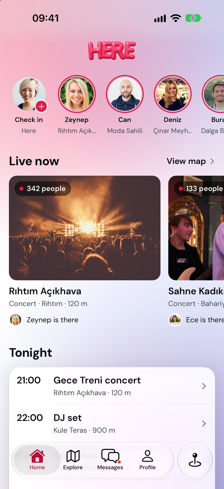<br>Home · live venues | 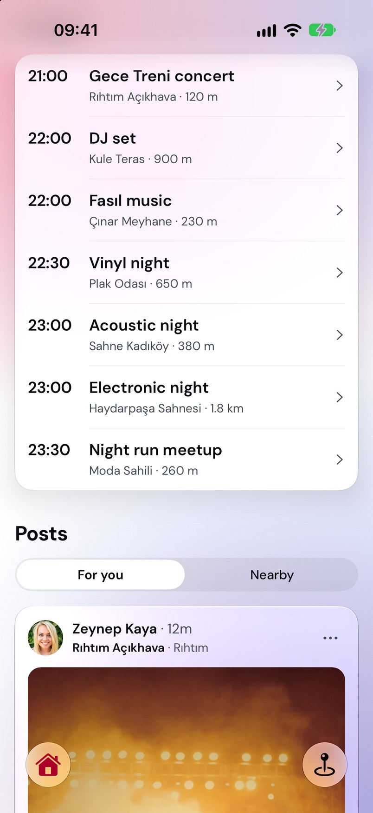<br>Tonight · events and posts | 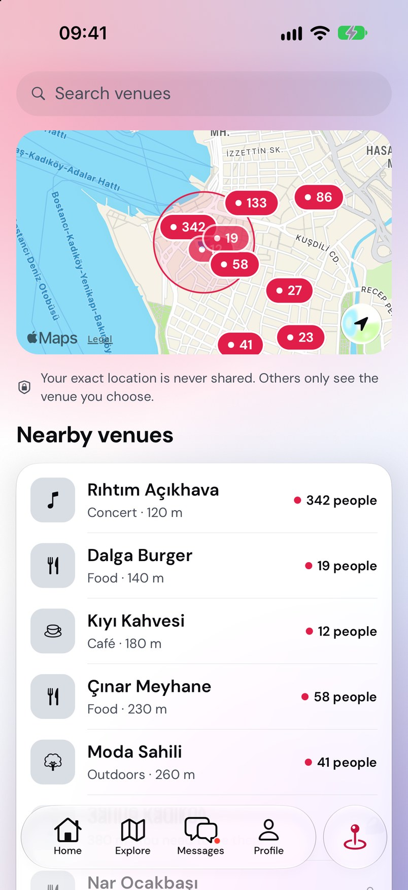<br>Here · venues around you |
| 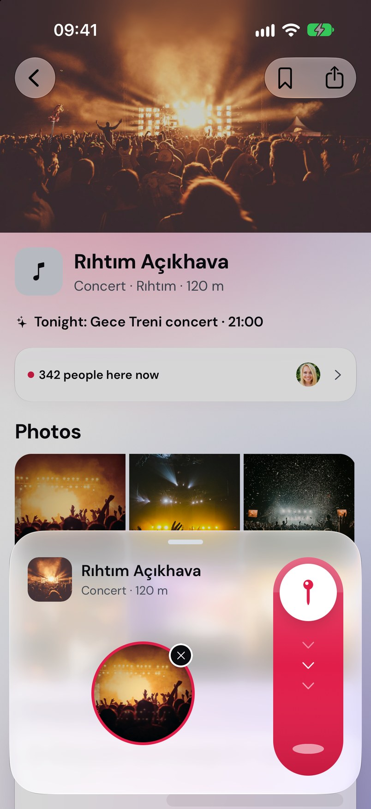<br>Check in · slide the pin | 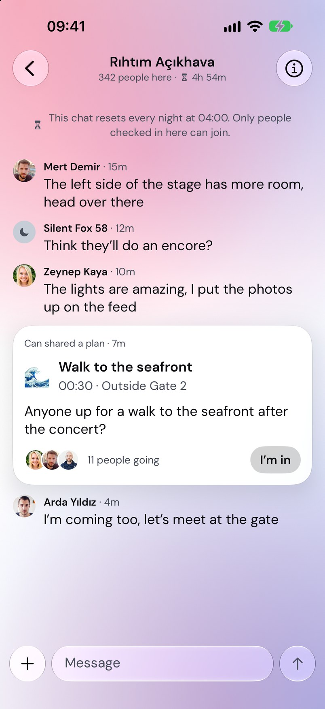<br>Venue chat · plan card | 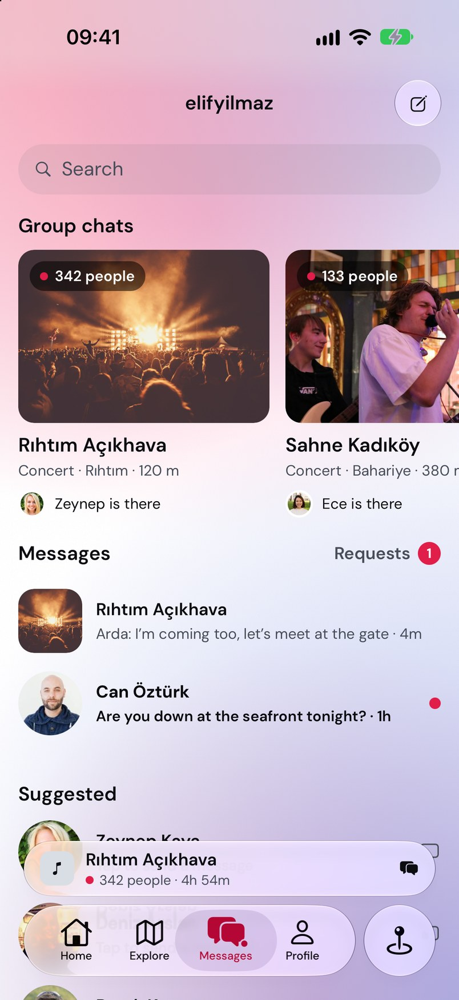<br>Messages · group chats |
| 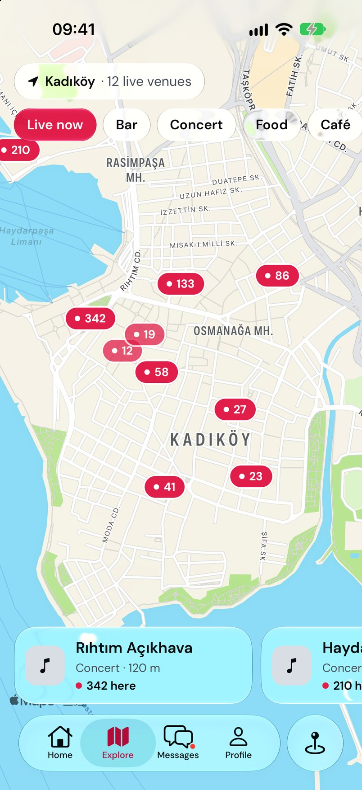<br>Explore · live map | 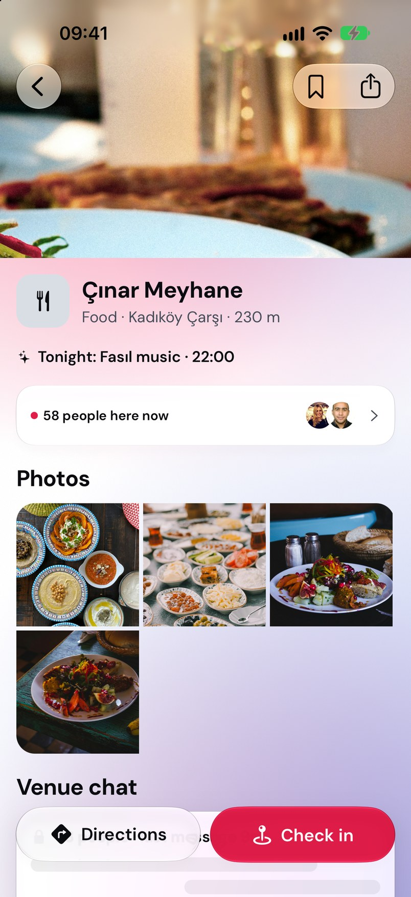<br>Venue page | 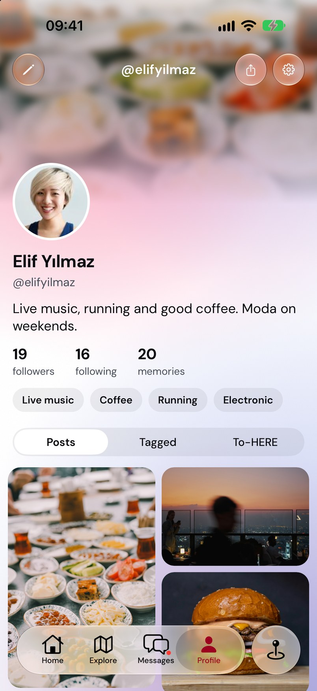<br>Profile |
| 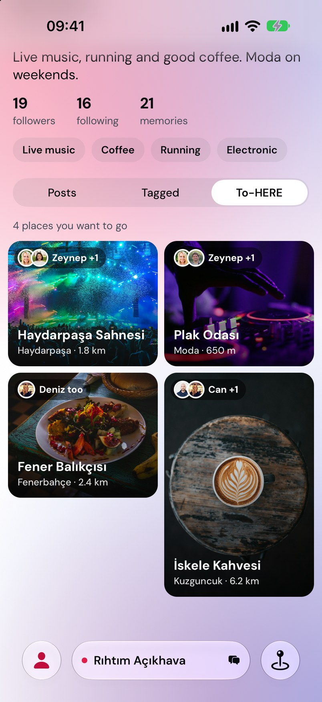<br>Profile · To-HERE list | 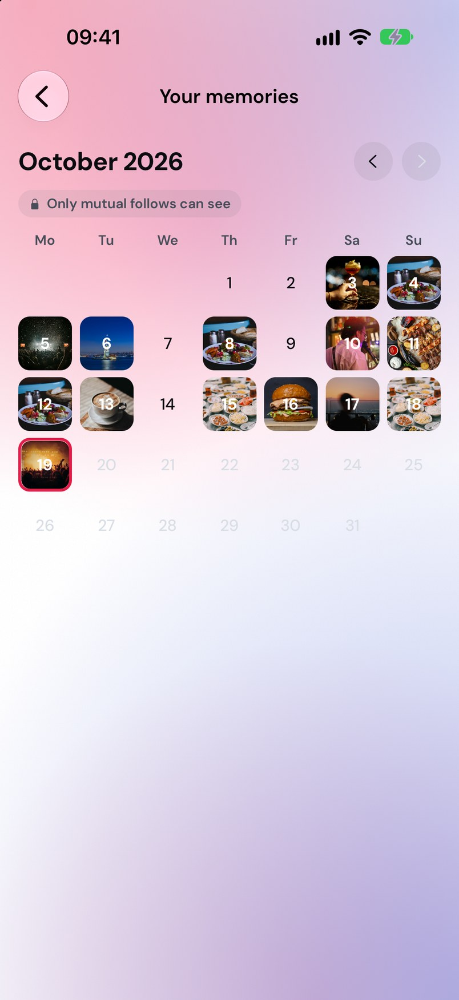<br>Memories | 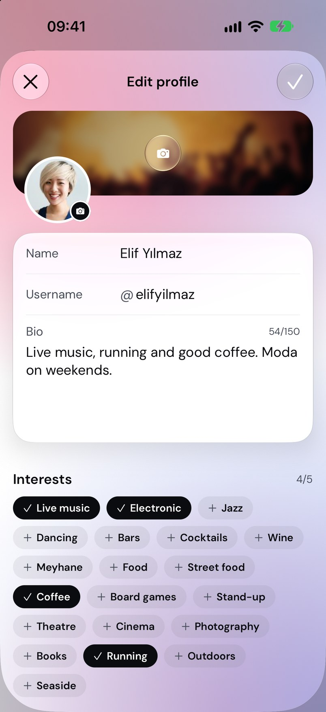<br>Edit profile |
| 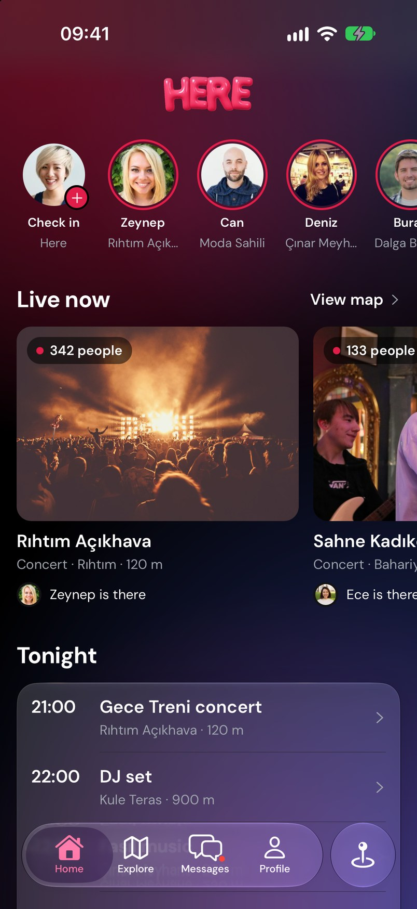<br>Dark · home | 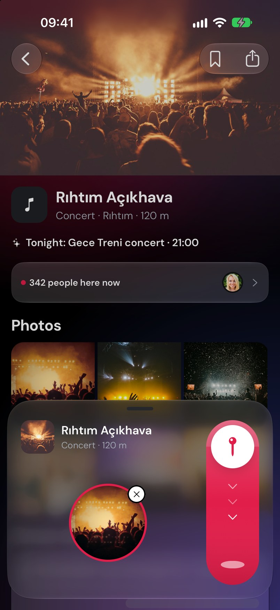<br>Dark · check in | 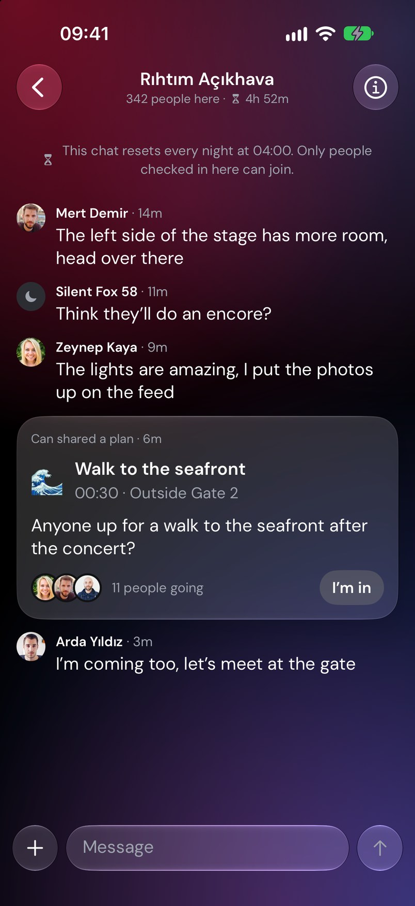<br>Dark · venue chat |
| 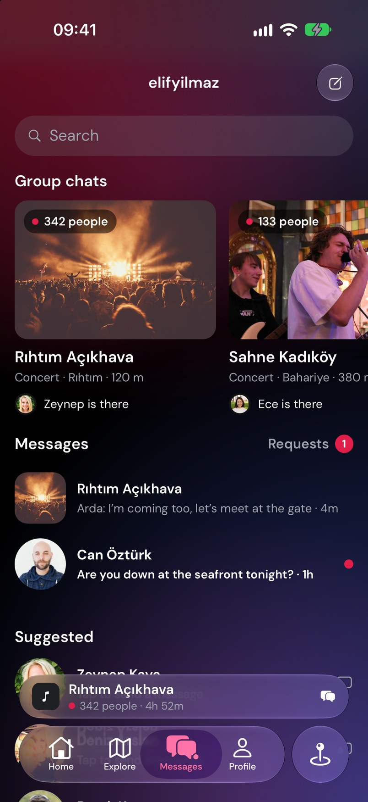<br>Dark · messages | 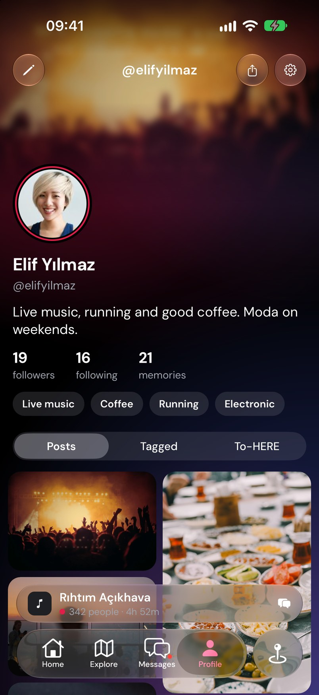<br>Dark · profile | 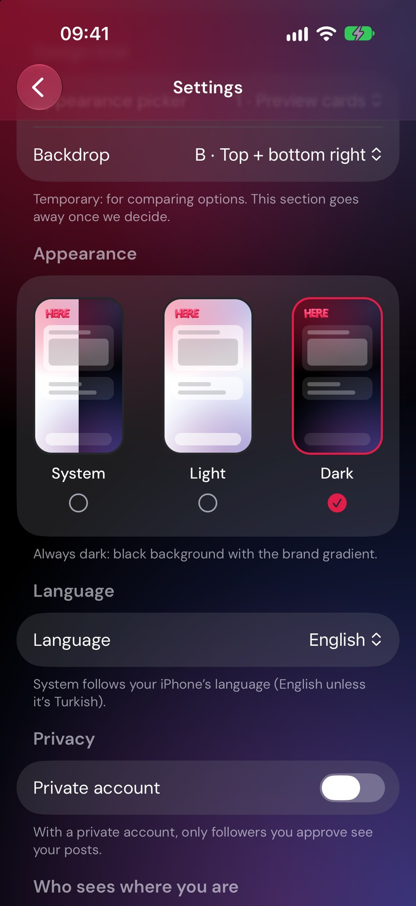<br>Settings · language |
| 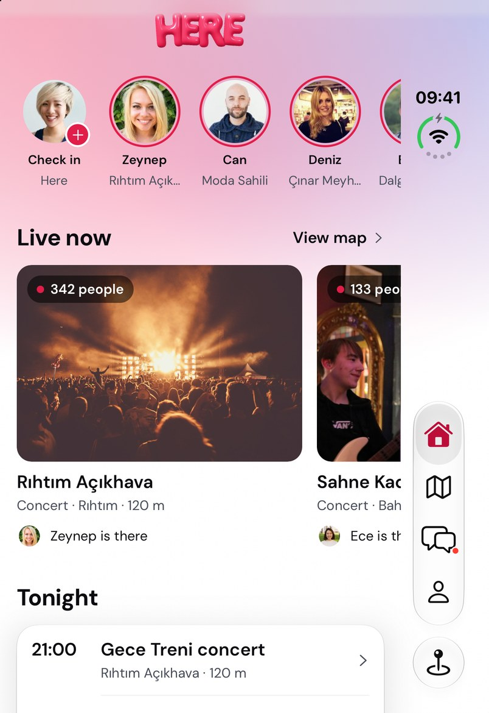<br>iPhone Duo · home | 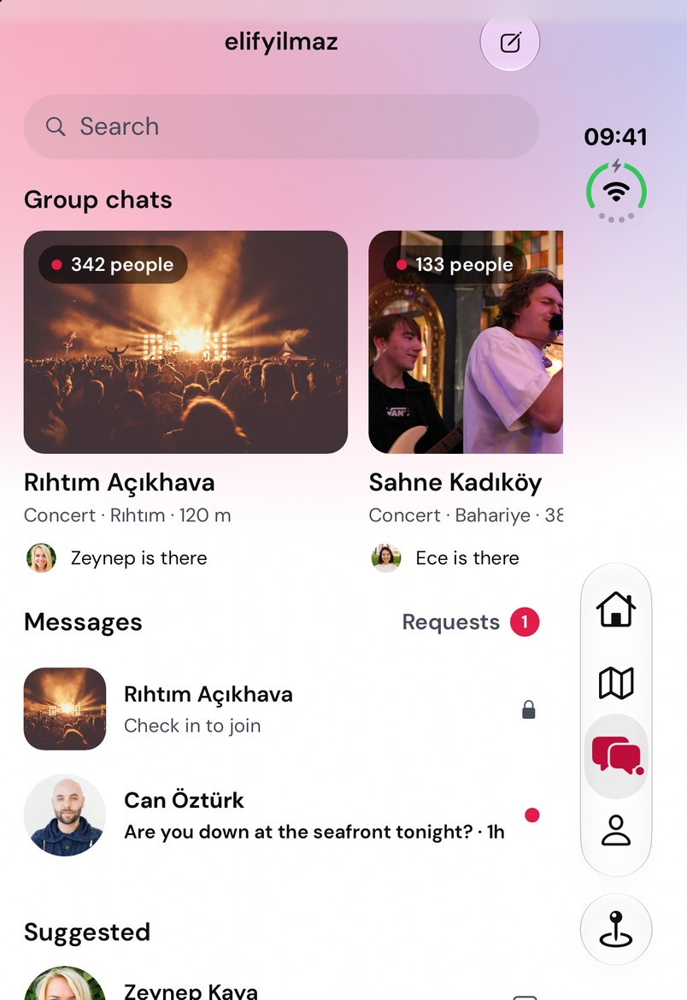<br>iPhone Duo · messages |  |

## Updating the kit

1. Run the app in the iOS simulator (iPhone 18 Pro, iOS 27) and set Settings › Language to English.
2. Save the screenshots listed in [`apps/mobile/scripts/build-media-kit.py`](../../apps/mobile/scripts/build-media-kit.py) to `docs/media-kit/screens/` as 804 px wide JPGs.
3. Build the board and the GitHub social preview (needs Pillow):

   ```bash
   cd apps/mobile && python3 scripts/build-media-kit.py
   ```

The social preview ([`social-preview.jpg`](social-preview.jpg), 1280 × 640) is uploaded by hand in the repository’s Settings › General › Social preview.
